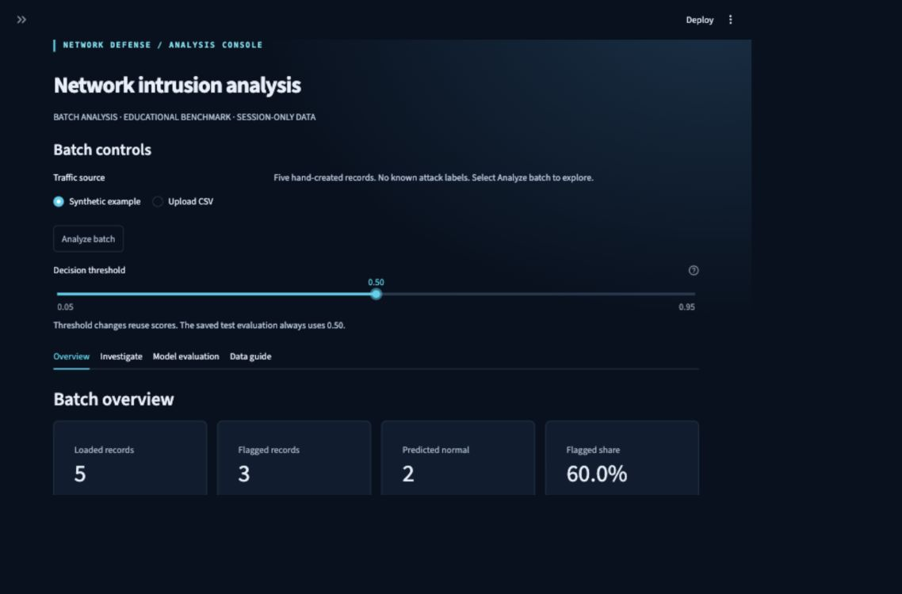

# Network intrusion analysis console

A dark, tactical-style **educational CSV analysis application** built with Python
and Streamlit. It compares Random Forest and Extra Trees, deploys the model chosen
on validation data, and provides batch investigation, threshold exploration,
feature importance, and downloadable predictions.



The preview uses synthetic example records, which have no known attack labels.

This application makes no military certification or operational-readiness claim.
It does not capture traffic, block connections, or manage persistent incidents.
Use public or synthetic data on the public deployment.

## Run locally

Install **Git and Python 3.12**. Dependencies are pinned to the versions used for
training and checks. A trained version 2 model bundle is included; no dataset
download, GPU, API key, or training is needed to explore the app. Internet access
is needed to install dependencies and, optionally, download the training data.

```bash
git clone https://github.com/Saumitra2315/network-intrusion-detection-ml.git
cd network-intrusion-detection-ml
python3.12 -m venv .venv
source .venv/bin/activate
python -m pip install -r requirements.txt
python -m streamlit run app.py
```

Open the local URL printed by Streamlit. Run subsequent commands from the cloned
repository directory with the virtual environment activated. To stop the server,
press **Ctrl+C** in its terminal.

Choose **Synthetic example**, then **Analyze batch**. The example contains five
hand-created records with no known attack labels. Their predictions demonstrate
the interface and do not measure detection quality.

- **Overview** shows full-batch counts, scores, and protocol/service breakdowns.
- **Investigate** filters records by prediction, protocol, service, and score,
  sorts them, and lets you inspect a record's features and missing cells.
- **Model evaluation** distinguishes validation-based model selection, interactive
  validation threshold tradeoffs, and fixed-threshold test evaluation.
- **Data guide** lists the feature contract and provides the synthetic example.

The Decision threshold slider changes labels using stored scores. It does not
rerun the model. Full and filtered exports record the active threshold and model.
The saved test report always uses threshold **0.50**.

## Project layout

| Path | Responsibility |
|---|---|
| `app.py` | Streamlit interface, batch session state, investigation, and evaluation views |
| `nids.py` | Feature contract, CSV validation, pipelines, thresholds, filters, and exports |
| `train.py` | Offline grouped validation, model selection, test evaluation, and artifact creation |
| `download_data.py` | Download the reference CSV mirror and verify SHA-256 hashes |
| `artifacts/` | Bundled trained model and reproducibility/evaluation metadata |
| `tests/` | Shared-logic tests and Streamlit application tests |
| `.streamlit/config.toml`, `style.css` | Upload limit, application theme, and responsive styling |
| `requirements.txt`, `requirements-dev.txt` | Pinned runtime and development dependencies |
| `sample.csv`, `docs/images/` | Synthetic demonstration input and application preview |
| `ATTRIBUTION.md` | Dataset provenance, usage terms, and requested references |

## Execution flow and responsibilities

```text
Offline:
separate training/test CSVs
  → train.py: validate the training partition
  → first grouped split: fitting records / validation records
  → fit two independent preprocessing-and-model pipelines
  → choose highest validation average precision, retain that fitted pipeline
  → evaluate selected model and baseline on the separate test partition
  → artifacts/model.joblib + artifacts/metadata.json

Online:
app.py: uploaded bytes or synthetic example
  → nids.read_csv: size, encoding, header, quoting, row count and row width checks
  → nids.predict: validate 42 model features and calculate attack scores
  → session memory: original scores, input features, analysis timestamp
  → nids.apply_threshold: derive Normal/Attack decisions without inference
  → overview / nids.filter_records / original-record inspector
  → nids.export_results: full or filtered predictions with threshold and model
```

`nids.py` owns the input schema and shared prediction behavior. Its allowlist
excludes `id`, `label`, and `attack_cat` regardless of what a visitor uploads.
Including target labels or their equivalents would invalidate the experiment.

Each saved scikit-learn `Pipeline` includes its fitted preprocessing and tree
ensemble. Numeric blanks receive fitting-set medians. Categorical blanks use a
missing-category representation; one-hot encoding creates indicator columns for
category values. Unknown categories receive no matching indicator. Accepting a
new protocol name does not establish that the model understands its behavior.

Random Forest and Extra Trees both combine 100 decision trees. Extra Trees uses
randomized split thresholds; the comparison determines which pipeline ranks
attacks better on this validation partition. Both have maximum depth 16, minimum
leaf size 2, balanced class weights, seed 42, and two workers. Random Forest retains
bootstrap sampling; Extra Trees retains its non-bootstrap default. These fixed
settings bound the comparison; there is no hyperparameter search or GPU requirement.

## Reproducible evaluation

The original training partition is split using the **first** split from
`StratifiedGroupKFold(n_splits=5, shuffle=True, random_state=42)`. Groups are hashes
of validated feature vectors with the index and target columns excluded. Identical
feature vectors remain together while class proportions are approximately retained.
This run uses **140,274 fitting** and **35,067 validation** records, with **zero
shared feature hashes** between them.

Both models fit their own preprocessing using only fitting records. Selection
maximizes validation **average precision**, which summarizes precision–recall
performance across thresholds. An exact tie favors Random Forest. The selected
pipeline is **not refitted** on validation records, so the saved validation curves
and threshold summaries describe the deployed artifact. Curves are sampled to at
most 200 display points; metric calculations use all scores.

Only after selection does training load the test partition for evaluation. The
baseline always predicts the fitting set's majority class. Reports include the
complete test file and a separate subset excluding feature hashes found anywhere
in the **original** training partition, including its validation portion. The
published files remain separate and unchanged.

Hash separation does not prove statistical independence: related traffic records
can have different features. The test file was also used for the previous version
of this educational project, so this is not a never-before-inspected benchmark.
Do not use interactive test results to choose a different model or threshold.

## Measured results

Selected **Random Forest** using validation average precision.

| Metric | Complete test file | No original-training feature hashes |
|---|---:|---:|
| Accuracy | 90.93% | 90.47% |
| Attack precision | 87.98% | 86.86% |
| Attack recall | 96.74% | 96.17% |
| Attack F1 | 92.15% | 91.28% |
| False-positive rate | 16.19% | 15.67% |
| ROC-AUC | 0.9843 | 0.9819 |
| Average precision | 0.9883 | 0.9848 |

Complete test: **82,332 records**. Hash-excluded subset: **73,791 records**. Both use threshold **0.50**.

**8,541 test records** have feature hashes in the original training partition. Full reports, baselines, confusion matrices, and validation comparison are in the dashboard and model metadata.

Precision measures how often a flag is correct. Recall measures the share of
attacks detected. F1 balances those quantities. False-positive rate measures the
share of normal records flagged. ROC-AUC summarizes ranking across thresholds.
Average precision summarizes precision–recall performance. These scores are not
calibrated probabilities, and feature importance is not an explanation of a
particular prediction. Impurity-based global importance can favor some feature
types; the UI groups encoded categories back to the original features.

The historical laboratory benchmark may differ substantially from a real network.
The observed false-positive rate is substantial. No real-network validation,
authentication, persistent alert handling, live capture, or automatic response is
provided by this version.

## Input, output, and privacy contract

- UTF-8 CSV with an optional byte-order mark, a header, and at least one record.
- Maximum **10,000 records and 10,000,000 bytes**; the server also caps uploads at 10 MB.
- All 42 feature columns in `sample.csv`, in any order. Feature meanings must match
  UNSW-NB15; arbitrary firewall logs or renamed fields are not interchangeable.
- `proto`, `service`, and `state` are categories; the other 39 features accept finite
  numeric values representable by the model. Empty cells are accepted.
- Extra columns are ignored. Duplicate/blank headers, malformed quoting, uneven
  widths, invalid numeric values, and exceeded limits produce actionable errors.
- The session threshold ranges from **0.05 to 0.95**, in steps of **0.05**, defaulting
  to **0.50**. Scores **equal to or above** it are flagged as Attack.
- Overview counts describe the complete batch. Investigation filters affect only
  the table, inspector, and filtered download. Empty category filters mean all.
- Sorting and filtering preserve the 1-based original CSV record number. The
  inspector shows validated input values and marks missing cells before imputation.
- Both prediction downloads contain `record`, `prediction`, `attack_score`,
  `threshold`, and `model`. Raw uploaded text is not echoed into exports. An empty
  filtered result still downloads a CSV containing the column header.

The app caches only its trusted model bundle. Uploaded records and predictions
stay in the visitor's session memory and are not written to disk, shared input
caches, a database, or application record logs. Changing the source or file clears
old predictions, input features, and investigation filters. Scoring is disabled
for an already-analyzed batch; threshold and filter changes reuse stored scores.
This is not a confidential-data hosting service: Streamlit and the host operate
their own infrastructure. Use public or synthetic records.

## Dataset and retraining

The official download redirected to Microsoft sign-in during setup. The downloader
uses an inspected public CSV mirror and checks SHA-256 hashes, rejecting changed
content. Counts and schema match the documented release. Equality with the
inaccessible official download is **unverified**. Exact reference URLs, file hashes,
actual profiles, fitting/validation index hashes, model settings, dependency
versions, training timestamp, and artifact checksum are in `artifacts/metadata.json`.

```bash
python download_data.py --directory data
python train.py \
  --train data/UNSW_NB15_training-set.csv \
  --test data/UNSW_NB15_testing-set.csv \
  --output artifacts-new
```

Training refuses an existing output directory or identical train/test files. It
writes a complete bundle in a temporary directory before moving it into place.
Review a new bundle before replacing `artifacts/`; the dashboard never trains.
Version 1 bundles are rejected with an upgrade message because they lack validation
comparison and investigation metadata.

Only load trusted model artifacts. Joblib uses Python serialization and is unsafe
for untrusted files. The bundled checksum detects accidental model/metadata
mismatch; it is not a digital signature. No model-upload capability is provided.

See [ATTRIBUTION.md](ATTRIBUTION.md) for UNSW-NB15 sources, academic-use terms, and
the references requested by the dataset authors.

## Checks and review

The completed local run passed **49 tests**, Ruff formatting and lint checks, and
dependency compatibility checks in a fresh Python 3.12.13 environment. Browser
checks exercised desktop and narrow layouts, sample analysis, keyboard controls,
threshold changes, filtering, record inspection, and a malformed CSV upload. An
actual downloaded filtered CSV was checked for its original record number, score,
threshold, model, and five-column contract. Cloud execution remains unverified.

```bash
python -m pip install -r requirements-dev.txt
python -m ruff format --check .
python -m ruff check .
python -m pytest -q
python -m pip check
```

Tests cover parser limits and errors, missing values and unknown categories,
exclusion of targets, threshold boundaries, grouped splitting, fitting-only
preprocessing, deterministic selection, single-class/empty evaluation subsets,
model persistence, global importance, downloader checksums, and the Streamlit
analysis/filter/inspection/download workflows. A spy checks that threshold changes
do not rerun inference. Session and replacement-file tests check isolation and
stale-result removal. Small fixture models exercise training without repeating
full-dataset training in the test suite.

When reviewing, follow the separation of fitting, validation, and test records;
check that the saved model is the one whose validation curves are displayed;
trace record numbers through filtering; and verify that displayed decisions and
exported decisions use the same threshold. Styling uses only application-owned
CSS; uploaded values are displayed through Streamlit rather than interpolated HTML.

## Deploy on Streamlit Community Cloud

Publishing this GitHub repository does not automatically deploy the web app.
The repository includes the application and trained artifacts needed for hosting;
setup scripts do not create a hosted service.

1. Use this repository, or fork it into your own account. Keep `style.css`,
   `sample.csv`, `ATTRIBUTION.md`, `.streamlit/config.toml`, pinned requirements,
   and the complete `artifacts/` bundle. Raw data, environments, and secrets are
   excluded by `.gitignore`.
2. Create/connect a Streamlit Community Cloud account using the intended GitHub
   account. Complete account terms and permission approvals yourself.
3. Create an app from the published repository/branch, with **app.py** as the
   entrypoint and **Python 3.12** selected. No app secrets or external ML service
   are required.
4. Check cloud build logs. At the public URL, analyze the sample, change the
   threshold, filter and inspect records, download full/filtered results, and
   upload an invalid CSV. Check that test reports remain fixed at 0.50.
5. Treat deployment as complete only after those hosted checks.

For this repository, the deployment settings are:

| Setting | Value |
|---|---|
| Repository | `Saumitra2315/network-intrusion-detection-ml` |
| Branch | `main` |
| Entrypoint | `app.py` |
| Python | `3.12` |

Free hosting has resource limits and can sleep when idle. Linux/cloud execution
remains unverified until the hosted checks run. For startup failures, check Python,
pinned dependencies, and the complete version 2 bundle rather than automatically
retraining on the host.

[Streamlit deployment documentation](https://docs.streamlit.io/deploy/streamlit-community-cloud/deploy-your-app/deploy)
